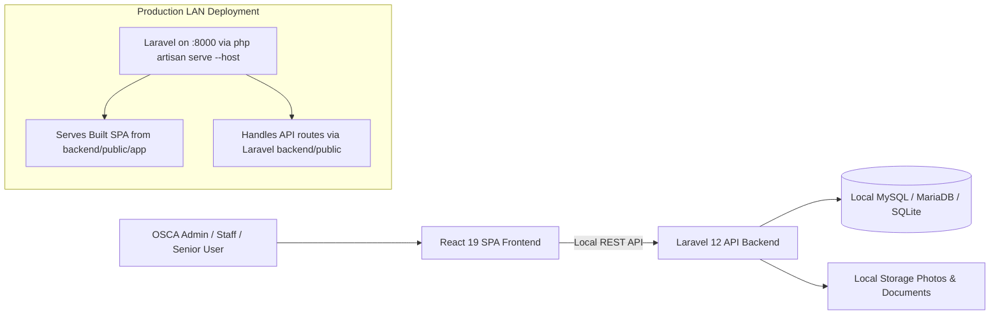

# OSCA Senior Citizen ID & Management System

<p align="center">
  <strong>Operational records, approval workflows, digital ID design, batch printing, and demographic reporting for OSCA Pagsanjan, Laguna.</strong>
</p>

<p align="center">
  Built with Laravel 12 &bull; React 19 &bull; TypeScript &bull; Vite 6 &bull; Tailwind CSS &bull; MySQL / SQLite
</p>

---

## Table of Contents

1. [Product Overview & Key Features](#1-product-overview--key-features)
2. [Architecture & Runtime Model](#2-architecture--runtime-model)
3. [System Requirements & Prerequisites](#3-system-requirements--prerequisites)
4. [Fresh Local Development Setup](#4-fresh-local-development-setup)
5. [Transferring the System to Other Devices](#5-transferring-the-system-to-other-devices)
   - [Updating an Existing Installation from a Laptop](#updating-an-existing-installation-from-a-laptop)
   - [Method A: Transfer via USB Flash Drive / ZIP (Offline / Air-Gapped)](#method-a-transfer-via-usb-flash-drive--zip-offline--air-gapped)
   - [Method B: Transfer via Git Repository](#method-b-transfer-via-git-repository)
   - [Migrating Existing Database & Uploaded Citizen Files](#migrating-existing-database--uploaded-citizen-files)
6. [Production Deployment on the Office LAN](#6-production-deployment-on-the-office-lan)
7. [100% Offline Operation Architecture](#7-100-offline-operation-architecture)
8. [Seeded Accounts & Roles](#8-seeded-accounts--roles)
9. [Available CLI Commands](#9-available-cli-commands)
10. [Troubleshooting & FAQ](#10-troubleshooting--faq)

---

## 1. Product Overview & Key Features

* **Member Registry**: Real-time searchable database of senior citizens with instant filters by 16 barangays, pension status, age brackets, and verification state.
* **Dual-Sided Digital ID Studio**: Interactive card builder with customizable drag-and-drop labels, QR code generation, front/back preview, and multi-card batch printing.
* **Smart Camera with AI Background Removal**: Live camera capture with client-side AI selfie segmentation (`@mediapipe`), 100% self-hosted with zero internet connection required.
* **Application Approval Workflow**: Review and manage pending registrations, document submissions, and profile change requests before committing to the official registry.
* **Audited Reporting & Excel Exports**: One-click generation of audited masterlists, centenarians roster, deceased records, and newly registered seniors.
* **Account Management & RBAC**: Role-based access control for Admins, Staff, and Senior Citizen self-service portal accounts.
* **Automated Audit Logs & Backups**: Complete audit trails for every record change, ID print, or deletion, with one-click database export and import tools.

---

## 2. Architecture & Runtime Model



### Runtime Modes:
* **Development Mode**:
  * Frontend Vite Dev Server runs at `http://localhost:3000` (or `3001` if busy).
  * Backend Laravel API runs at `http://127.0.0.1:8000`.
  * Vite proxy automatically routes `/api` calls to Laravel.
  * One-click start on Windows: run `APP\start.bat` (checks dependencies, boots `npm run dev`, opens the browser).
* **Production / LAN Mode (single service)**:
  * Build once with `npm run build:frontend` — the compiled SPA lands in `backend/public/app` (this folder is **not** committed to git; every fresh clone or transfer must rebuild it).
  * Serve `backend/` with `php artisan serve --host=0.0.0.0 --port=8000`: one port serves both the SPA (`/app`, with `/` redirecting to it) and the API (`/api`).
  * Accessible by other computers on the office network via the server's LAN IP (e.g. `http://192.168.1.100:8000/app`).

---

## 3. System Requirements & Prerequisites

### Minimum Hardware:
* **Processor**: Intel Core i3 / AMD Ryzen 3 or higher
* **RAM**: 4 GB minimum (8 GB recommended)
* **Storage**: 2 GB free disk space

### Software:
1. **Operating System**: Windows 10 / 11 is recommended (the `APP\start.bat` launcher and the automatic MySQL helper are Windows-only). macOS and Linux are supported when using the manual commands in [section 4](#4-fresh-local-development-setup).
2. **XAMPP with PHP 8.2 – 8.4**: XAMPP 8.2.x is the recommended version (it bundles PHP 8.2, MySQL/MariaDB and Apache).
   * [Download XAMPP](https://www.apachefriends.org/download.html)
   * Laravel 12 requires PHP `^8.2`, while the locked Excel library (`phpoffice/phpspreadsheet 1.30.x`) does **not** support PHP 8.5 yet. Use PHP 8.2, 8.3 or 8.4.
3. **Node.js 20.19+ or 22.12+**: Node 22 LTS is recommended (Node 24 also works). The current Vite/React toolchain no longer supports Node 18.
   * [Download Node.js](https://nodejs.org/)
4. **Composer**: Version 2.x (PHP Dependency Manager)
   * [Download Composer](https://getcomposer.org/download/)
5. **Git** (Optional, only for cloning the repository or Git-based transfers):
   * [Download Git](https://git-scm.com/downloads)
6. **Web browser**: A current version of Chrome, Edge or Firefox. Camera capture requires a secure context — it works on `localhost` or over HTTPS. When the app is opened over plain HTTP from another computer on the office LAN, use the photo upload button instead of the live camera.

### Verify the Tools Are Installed
Run these commands in a new terminal:
```bash
php -v          # Must report PHP 8.2.x, 8.3.x or 8.4.x
node -v         # Must report v20.19+ or v22.12+ (v22 LTS recommended)
npm -v
composer -V     # Must report Composer 2.x
```

### Required PHP Extensions in `php.ini`:
The backend needs the standard Laravel extensions plus the ones used by the Excel exporter. In XAMPP most of these are already enabled; ensure these lines are not commented out in `C:\xampp\php\php.ini`:
```ini
extension=curl
extension=fileinfo
extension=gd
extension=mbstring
extension=openssl
extension=pdo_mysql
extension=pdo_sqlite
extension=zip
```

The following are compiled into or enabled by default in XAMPP and are also required: `ctype`, `dom`, `iconv`, `libxml`, `simplexml`, `xml`, `xmlreader`, `xmlwriter`, `zlib`.

Confirm all modules are available:
```bash
php -m
```
If a module from the first group is missing, remove the leading `;` from its line in `php.ini`, save the file, and restart Apache/MySQL from the XAMPP Control Panel.

---

## 4. Fresh Local Development Setup

> **Quick Start (TL;DR)** — the condensed version of this section:
> ```bash
> git clone https://github.com/PikuFuka/OSCA.git
> cd OSCA
> npm install
> cd backend
> composer install
> copy .env.example .env
> php artisan key:generate
> cd ..
> cd frontend
> npm install
> copy .env.example .env
> cd ..
> ```
> Before running the migrations, create the `osca_db` database (Step 4) or switch `DB_CONNECTION=sqlite`. Then finish with:
> ```bash
> cd backend
> php artisan migrate --seed
> php artisan storage:link
> cd ..
> npm run dev
> ```
> On macOS/Linux, replace every `copy` with `cp`. Each step is explained in detail below.

Follow these steps when setting up the project for the first time from Git:

> **Internet access:** the first setup downloads Composer and npm packages. After `vendor/` and `node_modules/` exist and the frontend is built, the system runs completely offline (see [section 7](#7-100-offline-operation-architecture)).

### Step 1: Clone Repository
```bash
git clone https://github.com/PikuFuka/OSCA.git
cd OSCA
```

### Step 2: Install Root Dependencies
```bash
npm install
```

### Step 3: Setup Backend Environment
```bash
cd backend
composer install
copy .env.example .env
php artisan key:generate
```
*(On macOS / Linux, use `cp .env.example .env`.)*

> `composer install` must run on PHP 8.2 – 8.4. If Composer reports that `phpoffice/phpspreadsheet` requires `php <8.5`, switch XAMPP to a PHP 8.2/8.3/8.4 build before continuing.

### Step 4: Configure Database in `backend/.env`
Open `backend/.env` in any text editor and configure your database settings:

**Option A — MySQL (Default with XAMPP):**
1. Start **Apache** and **MySQL** in the XAMPP Control Panel.
2. Open `http://localhost/phpmyadmin` and create a database named `osca_db` with collation `utf8mb4_unicode_ci`, or run:
   ```sql
   CREATE DATABASE osca_db CHARACTER SET utf8mb4 COLLATE utf8mb4_unicode_ci;
   ```
3. In `backend/.env`:
```dotenv
DB_CONNECTION=mysql
DB_HOST=127.0.0.1
DB_PORT=3306
DB_DATABASE=osca_db
DB_USERNAME=root
DB_PASSWORD=
```

> The values above match a default XAMPP installation (`root` with no password). If your MySQL `root` account has a password, set `DB_PASSWORD` to that password. The same `DB_*` values can also be supplied through a `DB_URL` connection string.

**Option B — SQLite (Zero-setup database file):**
1. In `backend/.env`:
```dotenv
DB_CONNECTION=sqlite
```
2. Create an empty file at `backend/database/database.sqlite` from the `backend` directory:
   ```bash
   # Windows (cmd)
   type nul > database/database.sqlite
   # macOS / Linux
   touch database/database.sqlite
   ```

### Step 5: Run Migrations, Seeds & Link Storage
```bash
php artisan migrate --seed
php artisan storage:link
```

`--seed` creates the default Admin, Staff and Print Station accounts listed in [section 8](#8-seeded-accounts--roles). To use different seed credentials, set `ADMIN_PASSWORD`, `STAFF_PASSWORD` and `PRINT_PASSWORD` in `backend/.env` **before** running the command.

On macOS/Linux, also make Laravel's writable folders accessible:
```bash
chmod -R 775 storage bootstrap/cache
```

### Step 6: Setup Frontend
```bash
cd ../frontend
npm install
copy .env.example .env
```
*(On macOS / Linux, use `cp .env.example .env`.)*

Keep the default `VITE_API_URL=http://127.0.0.1:8000/api` for local development. For any other backend host or port — including a LAN server — point it at that server's URL without a trailing slash (for example `VITE_API_URL=http://192.168.1.100:8000/api`). The optional `GEMINI_API_KEY` value can be left empty; no internet connection is required at runtime.

### Step 7: Launch System
From the root `OSCA` directory:
```bash
cd ..
npm run dev
```

This starts three services concurrently:

| Service | Address |
| :--- | :--- |
| Laravel API | `http://127.0.0.1:8000` |
| Vite dev server (open this) | `http://localhost:3000` |
| MySQL | `127.0.0.1:3306` (started automatically when XAMPP is at `C:\xampp`) |

Open your browser at: **`http://localhost:3000`**

> **Note:** The automatic MySQL step uses `C:\xampp\mysql\bin\mysqld.exe`; if XAMPP is installed elsewhere, start MySQL from the XAMPP Control Panel first. On Windows you can also double-click `APP\start.bat` for a guided one-click launch that installs root dependencies if needed and opens the browser.

### Step 8: Verify the Installation
1. Confirm the API is responding: open `http://127.0.0.1:8000/api/seniors/next-id` — it should return JSON rather than a connection error.
2. Open `http://localhost:3000` and log in with the seeded administrator account `admin@osca.gov.ph` / `admin123`. You will be prompted to set a new password.
3. Optional smoke tests:
   ```bash
   cd backend
   php artisan test
   cd ../frontend
   npm run test
   ```

---

## 5. Transferring the System to Other Devices

When transferring the system to another office PC, laptop, or server, follow one of the two methods below.

---

### Updating an Existing Installation from a Laptop

Use this procedure when the other device already has OSCA installed and you only want to copy your latest website or code changes from your laptop. These steps update the application without replacing the target device's live database.

#### On Your Laptop (Source Device)

1. Make and test your changes locally.
2. Build the production website so the latest React files are included:
   ```bash
   npm run build:frontend
   ```
3. Copy the following to a USB drive or shared folder:
   * The changed project files, or the complete project folder if you are not using Git.
   * `backend/public/app` after the build. This is the compiled website used in LAN/production mode.
   * `backend/storage/app/public/` only if you added or changed uploaded photos/documents.

> Do not copy your laptop's `backend/.env` over the target device's `.env`. The target has its own database address, password, `APP_URL`, and LAN settings.

#### On the Other Device (Target Device)

1. Ask users to sign out, then stop OSCA and any running `php artisan serve`, Vite, or queue-worker windows.
2. Make a safety backup before replacing files:
   * Export the database from the OSCA Backup screen or phpMyAdmin.
   * Make a copy of the target's `backend/.env`.
   * Make a copy of `backend/storage/app/public/`.
3. Copy the updated application files from your laptop into the existing OSCA folder, replacing the old code. Keep these target-specific items:
   * `backend/.env`
   * The target MySQL database
   * `backend/storage/app/public/`
4. If `package.json` or `composer.json` changed, install dependencies from the project root:
   ```bash
   npm install
   cd backend
   composer install --no-dev --optimize-autoloader
   cd ..
   ```
5. If database migrations were included in the update, run them from `backend`:
   ```bash
   php artisan migrate --force
   php artisan optimize:clear
   ```
6. If you did not copy the already-built `backend/public/app`, rebuild it on the target:
   ```bash
   npm run build:frontend
   ```
7. Start OSCA again. For the normal development launcher, run `APP\start.bat`. For LAN/production mode, from `backend` run:
   ```bash
   php artisan serve --host=0.0.0.0 --port=8000
   ```
8. On each browser, open the website and press `Ctrl+F5` once to load the new bundle. Other devices should then use the same server URL as before, such as `http://192.168.1.100:8000/app`.

#### Updating Through Git Instead of USB

On the laptop, push the tested changes:
```bash
git add .
git commit -m "Update OSCA website"
git push origin main
```

On the target device, from the OSCA folder:
```bash
git pull origin main
npm install
npm run build:frontend
cd backend
composer install --no-dev --optimize-autoloader
php artisan migrate --force
php artisan optimize:clear
```

Review `backend/.env` after the pull and do not replace it with a laptop copy. Git does not transfer the database or uploaded files; migrate those separately using the backup and storage instructions below.

---

### Method A: Transfer via USB Flash Drive / ZIP (Offline / Air-Gapped)

Use this method when moving the system to a computer that has limited or no internet connection.

#### Step 1: Clean Up Source Project on the Old Device
Before copying the project to a USB flash drive, remove transient folders to save gigabytes of space and prevent symlink corruption:

Run in PowerShell or Command Prompt from the project root:
```bash
# Remove node_modules and vendor (they will be reinstalled cleanly)
rd /s /q node_modules
rd /s /q frontend\node_modules
rd /s /q backend\vendor

# Remove compiled SPA output (rebuilt with `npm run build:frontend`) and storage symlink
rd /s /q backend\public\app
rd /s /q backend\public\storage
```
Do **not** delete `backend/storage/app/public/` (citizen photos/documents) or `backend/.env` (copy its DB credentials manually — `.env` is never committed to git).

> **Air-gapped target?** `composer install` and `npm install` download packages from the internet. If the target computer has no connection, skip the `rd` commands above and copy `backend/vendor`, `node_modules` and `frontend/node_modules` along with the project, then skip those install commands in Step 4. Platform-specific binaries (esbuild, onnxruntime) must match the target operating system, so this works best when both computers run Windows.

#### Step 2: Export Database & Copy Uploaded Citizen Files
1. **Export Database**:
   * Open `http://localhost/phpmyadmin` &rarr; click `osca_db` &rarr; click **Export** &rarr; click **Export** (saves `osca_db.sql`).
   * *Or use the in-app backup view at `http://localhost:3000` &rarr; System Logs &rarr; Backup &rarr; Export Database.*
   * Place `osca_db.sql` into the project root folder.
2. **Citizen Photos & Files**:
   * Ensure `backend/storage/app/public/` is copied intact (this folder holds uploaded ID photos and verification documents).

#### Step 3: Copy Folder to New Device
Copy the entire `OSCA/` folder to the target computer (e.g. `C:\Users\<YourUsername>\Desktop\PROJECTS\OSCA`).

> The compiled SPA (`backend/public/app`) is git-ignored and was removed in Step 1 — it is rebuilt in Step 4 below. `backend/.env` is also never in git: re-enter the DB credentials from the old device's `.env` when you create the new one.

#### Step 4: Install & Initialize on the New Device
On the new computer (make sure XAMPP, Node.js, and Composer are installed):

1. **Start XAMPP MySQL & Apache** in XAMPP Control Panel.
2. **Create Database & Import SQL**:
   * Open `http://localhost/phpmyadmin` &rarr; Create database `osca_db`.
   * Click **Import** &rarr; choose `osca_db.sql` &rarr; click **Import**.
3. **Open a terminal in the `OSCA` project root, then run**:
   ```bash
   cd backend
   composer install
   copy .env.example .env
   php artisan key:generate
   php artisan migrate
   php artisan storage:link
   ```
4. **Open Terminal in `OSCA/frontend`**:
   ```bash
   cd ../frontend
   npm install
   copy .env.example .env
   npm run build
   ```
5. **Start System**:
   ```bash
   cd ..
   npm run dev
   ```
   *(Build first: `npm run dev` serves the API on `:8000`, but `/app` only works after `npm run build` creates `backend/public/app`.)*

---

### Method B: Transfer via Git Repository

Use this method if both machines have internet access or are on the same local Git server.

#### On the Source Device:
1. Commit and push any recent code changes:
   ```bash
   git add .
   git commit -m "Update OSCA system"
   git push origin main
   ```
2. Export your latest database from `http://localhost/phpmyadmin` or via MySQL CLI:
   ```bash
   mysqldump -u root osca_db > osca_backup.sql
   ```
3. Copy `osca_backup.sql` and the contents of `backend/storage/app/public` to a USB drive or cloud drive.

#### On the Target Device:
1. Clone the repository:
   ```bash
   git clone https://github.com/PikuFuka/OSCA.git
   cd OSCA
   ```
2. Install dependencies:
   ```bash
   npm install
   cd backend && composer install
   cd ../frontend && npm install
   ```
3. Setup `.env` and generate key:
   ```bash
   cd ../backend
   copy .env.example .env
   php artisan key:generate
   ```
4. Import database:
   * Create `osca_db` in phpMyAdmin.
   * Import `osca_backup.sql`.
5. Restore citizen uploaded files:
   * Paste the copied files into `backend/storage/app/public/`.
   * Run `php artisan storage:link`.
6. Build the frontend bundle (required — `backend/public/app` is git-ignored):
   ```bash
   cd ../frontend && npm install && copy .env.example .env && npm run build
   ```
7. Run the application:
   ```bash
   cd ..
   npm run dev
   ```

---

### Migrating Existing Database & Uploaded Citizen Files

Whenever moving live senior records between machines:

| Item | Source Location | Destination Location | How to Migrate |
| :--- | :--- | :--- | :--- |
| **Database Data** | MySQL `osca_db` | MySQL `osca_db` | Export `.sql` from phpMyAdmin on old PC, Import into phpMyAdmin on new PC. |
| **Profile Photos & Documents** | `backend/storage/app/public/` | `backend/storage/app/public/` | Copy folder contents, then run `php artisan storage:link` in `backend/`. |
| **System Environment** | `backend/.env` | `backend/.env` | Copy DB credentials, verify `APP_KEY` matches if encrypted tokens are used. |

---

## 6. Production Deployment on the Office LAN

To run the system as a permanent office service accessible by multiple computers over LAN (single service, no Apache configuration needed):

### Step 1: Build the Production Frontend
From the root directory:
```bash
npm run build:frontend
```
This compiles the React app directly into `backend/public/app` (git-ignored — rebuild after every `git pull` that changes frontend code).

### Step 2: Configure `backend/.env` for Production
```dotenv
APP_ENV=production
APP_DEBUG=false
APP_URL=http://YOUR_SERVER_LAN_IP:8000
```
*(Example: `APP_URL=http://192.168.1.100:8000`. Keep `DB_*` pointing at the server's MySQL and `SANCTUM_STATEFUL_DOMAINS` including every host:port staff use.)*

### Step 3: Serve on the LAN & Open Firewall
1. From `backend/`, run:
   ```bash
   php artisan serve --host=0.0.0.0 --port=8000
   ```
   (Keep this window open, or run it as a scheduled task / service. The same port serves `/app` and `/api`.)
2. In Windows Firewall &rarr; Allow an app &rarr; allow inbound TCP on port `8000` for Private networks.
3. Access from any device on the network:
   * From server: `http://localhost:8000/app`
   * From other PCs: `http://192.168.1.100:8000/app`

### Optional: Run the Queue Worker
Async report generation and database backup/import use Laravel's database queue. To process requests that use `?async=1` or `?queue=1`, keep a worker running in a second terminal from `backend/`:
```bash
php artisan queue:work
```
Normal synchronous Excel downloads and backups work without a worker; only explicitly queued jobs wait in the `jobs` table.

---

## 7. 100% Offline Operation Architecture

The OSCA system is specifically architected to work in **100% air-gapped environments with zero active internet connection**:

* **Self-Hosted AI Camera**: MediaPipe selfie segmentation models (`.tflite`), SIMD binaries, and WASM files are bundled locally under `/frontend/public/mediapipe/selfie_segmentation/`. No CDN downloads are required.
* **Self-Hosted Typography**: Inter font files are bundled into the app distribution (`.woff2`). No Google Fonts network requests are made.
* **Local Compute & Storage**: All PDF printing, canvas rendering, Excel document generation, and database queries run entirely on the host machine.

---

## 8. Seeded Accounts & Roles

When running `php artisan db:seed`, the following accounts are initialized:

| Role | Email / Identifier | Password | Permissions |
| :--- | :--- | :--- | :--- |
| **Administrator** | `admin@osca.gov.ph` | `admin123` | Full access (Registry, Approvals, Accounts, System Logs, Database Backup) |
| **Staff Member** | `staff@osca.gov.ph` | `staff123` | Operations (Registry, Approvals, Registration, Batch Print, Reports) |
| **Print Station** | `print@osca.gov.ph` | `print123` | Staff role scoped for batch ID printing (opens the Batch Print view on login) |
| **Senior Citizen** | OSCA ID (e.g. `24-0001`) | Set upon registration | Personal Portal (View Status, Digital ID Review, Update Request) |

> **Important**: Change default administrator and staff passwords immediately after deployment in production.
> Seeded accounts are created with `force_password_change`, so each one must set a new password on first login. Override the defaults non-interactively via `ADMIN_EMAIL` / `ADMIN_PASSWORD` (and `STAFF_*`, `PRINT_*`) in `backend/.env` before seeding.

---

## 9. Available CLI Commands

### Root Workspace Commands
```bash
npm run dev              # Starts MySQL + Laravel API + Vite Dev Server concurrently
npm run mysql            # Starts XAMPP MySQL only (scripts/mysql-start.cjs)
npm run backend          # Starts the Laravel API only (php artisan serve)
npm run frontend         # Starts the Vite dev server only
npm run build:frontend   # Compiles frontend SPA into backend/public/app for LAN serving
npm run deploy:apache    # Alias of build:frontend (kept for backward compatibility)
```

### Backend Commands (`cd backend`)
```bash
php artisan serve        # Runs local Laravel dev server at 127.0.0.1:8000
php artisan migrate      # Runs database migrations
php artisan db:seed      # Seeds default admin, staff and print accounts
php artisan storage:link # Creates public symlink for uploaded citizen documents
php artisan queue:work   # Processes queued report/backup jobs (optional)
php artisan test         # Runs automated PHPUnit backend tests
```

### Frontend Commands (`cd frontend`)
```bash
npm run dev              # Starts Vite dev server at http://localhost:3000
npm run build            # Builds production assets to ../backend/public/app
npm run test             # Runs Vitest unit tests once
npm run test:watch       # Runs Vitest in watch mode
```

---

## 10. Troubleshooting & FAQ

### 1. `php` or `composer` is not recognized
* Ensure `C:\xampp\php` is added to your Windows Environment `PATH` variable.
* Ensure Composer bin directory (usually `C:\ProgramData\ComposerSetup\bin`) is in `PATH`.

### 2. Uploaded photos or documents return 404 / broken image
* The storage symlink is missing. Open terminal in `backend/` and run:
  ```bash
  php artisan storage:link
  ```

### 3. Database connection refused (`SQLSTATE[HY000] [2002]`)
* Make sure MySQL is running in the XAMPP Control Panel.
* Verify port `3306` and credentials in `backend/.env`.

### 4. Port 3000 is already in use
* Vite will automatically assign port `3001` or `3002`. You can also close the competing application or specify a custom port in `frontend/vite.config.ts`.

### 5. Browser shows 503 / 404 on `/app`
* The frontend production bundle has not been built yet (it is git-ignored). Run from project root:
  ```bash
  npm run build:frontend
  ```

### 6. App shows stale content after an update
* Hard-refresh the browser (`Ctrl+F5`). If the UI still looks old, rebuild (`npm run build:frontend`) and hard-refresh again — the bundle filename changes on every build, so a fresh HTML entry point always loads fresh assets.

### 7. API calls fail with 401 after login, or downloads open a login page
* The auth token in the browser is expired or was revoked: sign out and sign back in.
* In development, make sure `frontend/.env` has `VITE_API_URL=http://127.0.0.1:8000/api` and `backend/.env` lists the dev origins in `SANCTUM_STATEFUL_DOMAINS`.

### 8. Vite fails with a Node.js version error
* The current frontend toolchain requires **Node.js 20.19+ or 22.12+** (Node 22 LTS recommended). Node 18 is no longer supported. Install a newer Node.js release, delete `frontend/node_modules`, and run `npm install` again.

### 9. Composer fails with `phpoffice/phpspreadsheet ... requires php < 8.5`
* The locked Excel library does not support PHP 8.5 yet. Switch XAMPP to a PHP 8.2, 8.3 or 8.4 build, then run `composer install` again.

### 10. Excel export fails with a `ZipArchive` or GD error
* Enable `extension=zip` and `extension=gd` in `C:\xampp\php\php.ini`, save the file, and restart Apache/MySQL. Confirm both appear in `php -m`.

### 11. Live camera preview is blank when the app is opened from another PC
* Browsers only allow camera access on `localhost` or HTTPS. Over plain HTTP on the LAN, use the photo upload button in the member form, or publish the app over HTTPS.

### 12. `npm run dev` cannot find MySQL on macOS / Linux or a custom XAMPP path
* `scripts/mysql-start.cjs` expects XAMPP at `C:\xampp`. Start MySQL manually, then run `npm run backend` and `npm run frontend` in **separate terminals**.

### 13. Database backup reports that `mysqldump` is unavailable
* Add `C:\xampp\mysql\bin` to your Windows `PATH`, or run the backup from the in-app Backup view — it falls back to a PHP-generated SQL dump when the CLI tool is missing.

---

*OSCA Senior Citizen ID System &bull; Municipal Government of Pagsanjan, Laguna &bull; Developed for reliable offline governance.*